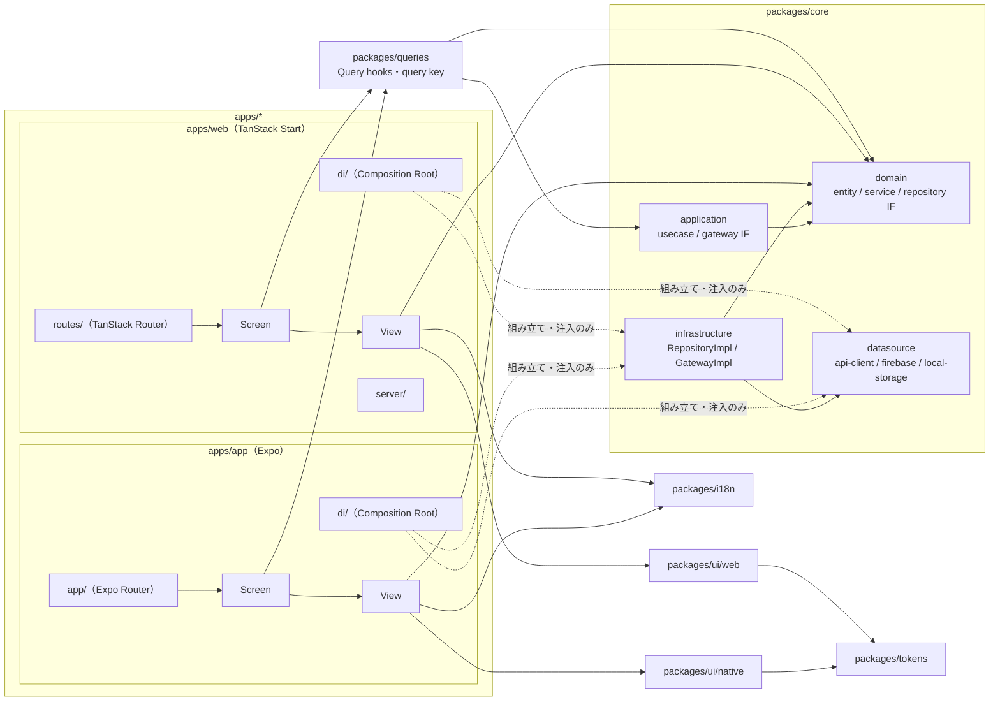
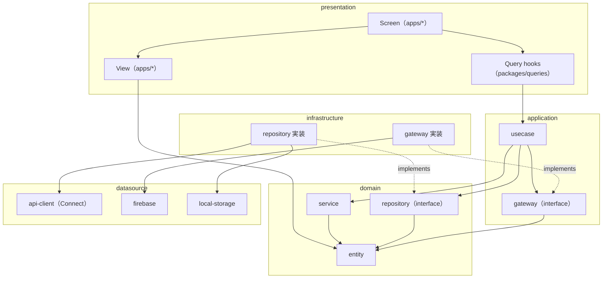

# Dotto Client 設計方針

`fun-dotto/app`（Flutter）と `fun-dotto/web`（Next.js）を本リポジトリ `fun-dotto/client` に統合し、
単一の TypeScript モノレポとして再構築する。

## 決定事項

| 項目 | 方針 |
| --- | --- |
| リポジトリ構成 | `client` に統合したモノレポ（Bun workspaces） |
| ランタイム / パッケージマネージャ | **Bun**（パッケージ管理・スクリプト実行）。Node は Metro / Expo CLI の実行用としてのみ使用。Bun 起因の問題が解消できない場合は pnpm に切り替える |
| タスク実行 | `bun run --filter` で実行。ビルド時間が問題になったら Turborepo を導入する |
| アプリ（iOS / Android） | **React Native + Expo**（CNG / Expo Router / EAS Update）。ビルド・ストア提出は GitHub Actions 上で `eas build --local` |
| Web | **TanStack Start**（Vite）。**Cloud Run** に Docker でデプロイ |
| 共有範囲 | **ロジックのみ共有**（core・Query hooks・i18n・デザイントークン）。画面と UI コンポーネントはアプリと Web で別々に実装 |
| デザインシステム | **コードベースを正本**とする。デザイントークン（`packages/tokens`）と UI コンポーネント（`packages/ui/native`・`packages/ui/web`）をアプリから切り出し、UI コンポーネントはステートレスにする |
| UI | アプリは**プラットフォームネイティブを優先**、Web はネイティブ HTML 要素 + Tailwind |
| 画面 | **Screen（状態を持つ）と View（ステートレス）に分離**。VRT は View を props だけで表示して撮る |
| アーキテクチャ | **Clean Architecture 寄りのレイヤー分割**（domain / application / infrastructure / datasource / presentation）。レイヤーはパッケージではなく `packages/core` 内のディレクトリで分け、依存は内側（domain）へ一方向 |
| API | **Buf + Connect**（バックエンドの Connect 置き換えを前提）。`.proto` からの生成型 + Connect-ES クライアント |
| インフラ | クライアントが使うインフラ設定は **`fun-dotto/infra` の Terraform** で管理（このリポジトリには IaC を置かない） |
| 移行 | **一括リプレイス**：全機能を `client` で実装完了後に一斉に切替え、`app` / `web` をアーカイブ |

## ディレクトリ構成

```
client/
├── apps/
│   ├── app/                 # Expo (iOS / Android)
│   │   └── src/
│   │       ├── app/         #   Expo Router のルート（薄いラッパー）
│   │       ├── screens/     #   画面ごとのディレクトリ（フラットに配置）
│   │       │   └── <Name>/  #     <Name>Screen.tsx（状態を持つ）・<Name>View.tsx（ステートレス）・画面固有の部品
│   │       └── di/          #   Composition Root
│   └── web/                 # TanStack Start
│       └── src/
│           ├── routes/      #   TanStack Router のルート
│           ├── screens/     #   画面ごとのディレクトリ（構成はアプリと同じ）
│           ├── server/      #   server functions・セッション Cookie
│           └── di/          #   Composition Root
├── packages/
│   ├── core/                # ドメインロジック（React 非依存）
│   │   └── src/
│   │       ├── domain/          # ビジネスの中心（依存なし）
│   │       │   ├── entity/      #   Entity・値オブジェクト・純粋なドメインロジック
│   │       │   ├── service/     #   Domain Service（複数の Entity にまたがる純粋なドメインロジック）
│   │       │   └── repository/  #   Repository interface（ドメインデータの取得・保存）
│   │       ├── application/     # アプリケーションのユースケース
│   │       │   ├── usecase/     #   1 つのユーザー操作に対応する処理（hooks の唯一の入口）
│   │       │   └── gateway/     #   Gateway interface（認証・Analytics・通知等の外部サービス）
│   │       ├── infrastructure/  # domain / application の interface の実装（機能ごとのディレクトリ）
│   │       │   ├── repository/
│   │       │   │   └── bus/
│   │       │   │       └── BusRepositoryImpl.ts  # datasource の組み合わせ・キャッシュ方針・Proto→Entity 変換
│   │       │   └── gateway/
│   │       │       └── auth/
│   │       │           └── AuthGatewayImpl.ts
│   │       └── datasource/      # 外部 SDK・技術要素の薄いラッパー（ドメイン非依存）
│   │           ├── api-client/  #   buf generate の生成物 + Connect transport + 認証 interceptor
│   │           ├── firebase/    #   native: @react-native-firebase / web: firebase JS SDK
│   │           └── local-storage/ # native: react-native-mmkv / web: localStorage（条件付き exports で切り替え）
│   ├── queries/             # TanStack Query hooks・query key（アプリ / Web 共通の presentation 層）
│   ├── i18n/                # 文言（現 app の l10n を移植）
│   ├── tokens/              # デザイントークンの正本（TS、依存なし）
│   │   ├── src/
│   │   │   ├── primitive.ts #   生の色・サイズ等（外部に公開しない）
│   │   │   ├── semantic.ts  #   用途名 → primitive（light / dark の値を持つ）
│   │   │   └── index.ts     #   semantic のみ公開
│   │   └── build/           #   プラットフォーム向けの生成物（web.css：Tailwind v4 の @theme + CSS 変数 / native.ts：RN・@expo/ui 向けの値）
│   ├── ui/
│   │   ├── native/          # アプリ用のステートレスな UI コンポーネント（@expo/ui・RN プリミティブ）+ オンデバイス Storybook
│   │   └── web/             # Web 用のステートレスな UI コンポーネント（HTML + Tailwind）+ Storybook
│   └── config/              # tsconfig / Biome 等の共有設定（ツール設定のみ）
├── buf.gen.yaml
├── docs/
├── package.json             # workspaces 定義
├── bun.lock
└── mise.toml
```

依存方向は以下の一方向とする。



`packages/core` 内のレイヤー構成（依存は内側の `domain` へ向かう）は以下のとおり。



- `domain` は何にも依存しない。`queries` は `application` の UseCase のみを呼び、Repository / Gateway を直接呼ばない。`application` は `domain`（Entity・Domain Service・Repository interface）と自身の Gateway interface のみを参照する。Domain Service は Entity のみに依存し、Repository / Gateway を呼ばない（必要なデータは UseCase が取得して引数で渡す）。いずれも `infrastructure` / `datasource` を直接 import しない。
- `datasource` は `domain` を参照しない（生成型・SDK の型のみを扱う）。Entity への変換は `infrastructure` で行う。
- `packages/core` 内のレイヤー間の依存方向は、`package.json` の `exports`（レイヤーごとのサブパス公開）と dependency-cruiser（または Biome の `noRestrictedImports`）で CI 検証する。
- 各アプリの `di/` が Composition Root となり、Repository / Gateway 実装を組み立てて UseCase に渡し、UseCase を React Context で注入する。テスト・Storybook ではモック実装に差し替える。
- `packages/*` から `apps/*` を参照しない。`apps/app` と `apps/web` は互いに参照しない。`packages/config` は devDependency としてのみ参照する。
- `tokens` は何にも依存しない。`ui/native`・`ui/web` は `tokens` にのみ依存し、`core`・`queries`・`i18n`・ルーターを参照しない。`ui/native` と `ui/web` は互いに参照しない。
- `domain` の `entity/`・`service/`・`repository/`、`application` の `usecase/`・`gateway/` はフラットに置く（1 機能 1 ファイルで済むため）。`infrastructure` の `repository/`・`gateway/` は機能ごとのディレクトリに分ける（Impl・Proto→Entity 変換・プラットフォーム別 Impl・テストが機能ごとに複数ファイルになるため）。
- `ui/native`・`ui/web` はそれぞれ独立した workspace パッケージにする（`packages/ui/*` を workspaces に登録）。RN と Web の依存を混ぜないためである。

### 各レイヤーの責務

| レイヤー | 場所 | 責務 | 置かないもの |
| --- | --- | --- | --- |
| domain | core | Entity・値オブジェクト・純粋なドメインロジック、Domain Service、Repository interface | 生成型（Proto message）・SDK・React |
| application | core | usecase：1 つのユーザー操作に対応し、Repository / Gateway を呼び出す（単純な取得でも必ず UseCase を通す）。gateway：UseCase が使う外部サービスの interface | React・infrastructure / datasource の参照 |
| infrastructure | core | Repository / Gateway の実装。datasource の組み合わせ・キャッシュ方針・Proto/DTO→Entity 変換・エラーのドメイン化 | HTTP・SDK の詳細 |
| datasource | core | 通信・永続化・Firebase の技術的な関心事（ヘッダー、リトライ、エラー変換、プラットフォーム差分） | ドメイン知識・Entity |
| presentation（共通） | queries | Query hooks・query key・キャッシュ無効化 | UI・ルーター・生成型 |
| presentation（Screen） | apps/* | 画面状態（Query hooks・ルートパラメータ・ナビゲーション・フォーム・Zustand）を View の props に変換する | レイアウト・スタイル、生成型・SDK の直接利用 |
| presentation（View） | apps/* | 画面のレイアウト。ui のコンポーネントと画面固有の部品を組み合わせ、loading / error / empty / データありを props で表す（ステートレス） | `queries`・`infrastructure` の参照、データ取得 |
| デザインシステム | ui/*・tokens | 画面をまたいで再利用するステートレスな UI コンポーネント、デザイントークン | ドメイン知識・Entity・文言 |

- Repository はドメインデータ（お知らせ・バス・時間割等）の取得・保存、Gateway はそれ以外の外部サービス（認証・Analytics・プッシュ通知・Remote Config 等）を表す。Repository interface はドメインの関心事なので `domain`、Gateway interface は UseCase を動かすための技術的な関心事なので `application` に置く。
- hooks から呼ぶ処理はすべて UseCase にする。単純な取得の素通しでも UseCase を作り、hooks から Repository / Gateway を直接呼ばない。呼び出し口を揃え、後からロジックが増えても hooks を変更せずに済むようにするためである。UseCase から別の UseCase は呼ばない。
- 1 つの Entity に収まらないドメインロジック（複数 Entity の比較・集計・判定等）は `domain/service/` の Domain Service に置く。Repository / Gateway を呼ばない純粋な関数・クラスとし、UseCase から呼ぶ。I/O を伴う共通処理は UseCase に重複して書くか Repository 実装に寄せ、application 層に Service は作らない。
### プラットフォーム差分

interface は共通で実装だけをアプリ / Web で切り替える場合、差分の種類によって切り替える層を分ける。上位層（`application` / `queries` / 画面）は差分を意識しない。

| 差分の種類 | 例 | 切り替える層 | 方法 |
| --- | --- | --- | --- |
| SDK・技術要素の差 | Firebase（`@react-native-firebase` / firebase JS SDK）、storage（MMKV / localStorage） | `datasource` | `package.json` の条件付き `exports` |
| 振る舞いの差 | 認証フロー（google-signin / popup・redirect）、Web 非対応機能（通知は no-op）、キャッシュ方針（永続化の有無） | `infrastructure` | プラットフォーム別の Impl を作り、各アプリの `di/` で選んで注入 |
| Web の SSR / ブラウザの差 | API 認証（セッション Cookie + Admin SDK / ID トークン） | `datasource` | 条件付き `exports`（`node` / `browser`） |
| iOS / Android の差 | UI・ネイティブ API | `apps/app`・`ui/native` | ファイル拡張子（`*.ios.tsx` / `*.android.tsx`） |

- **datasource の切り替えは条件付き `exports` で行う**。`packages/core` の `package.json` で、サブパスごとに `react-native` / `browser` / `node` / `default` の条件で解決先を分ける。Metro・Vite・Bun・tsc が同じ仕組みで解決でき、拡張子による解決（`resolve.extensions` の追加や tsconfig の `moduleSuffixes`）は使わない。

  ```jsonc
  "exports": {
    "./datasource/local-storage": {
      "types": "./src/datasource/local-storage/index.ts",
      "react-native": "./src/datasource/local-storage/native.ts",
      "browser": "./src/datasource/local-storage/web.ts",
      "node": "./src/datasource/local-storage/server.ts",
      "default": "./src/datasource/local-storage/web.ts"
    }
  }
  ```

  - `types` には共通の interface を置き、各実装はそれを満たすようにする（tsc はプラットフォームに依存せず型を検査できる）。
  - `bun test` は既定で `node` 条件で解決する。各実装を直接 import してテストするか、`--conditions` で切り替える。
- **infrastructure の差分は Impl を分けて DI で選ぶ**。`infrastructure/<種別>/<機能>/` に `Native<Name>Impl.ts` / `Web<Name>Impl.ts` のように並べ、各アプリの `di/` が使う方を組み立てる。共通部分は 1 つの Impl にまとめ、差分は constructor で渡す datasource や戦略で表す。Impl を分けるのは、振る舞いそのものが異なる場合だけにする。Web で対応しない機能は no-op の Impl を注入し、上位層では分岐しない。

## ツールチェーン

- **Bun**: `bun install` / `bun run` / `bunx`。ロックファイルは `bun.lock` をコミット。
  - Metro の symlink 解決・ネイティブモジュール等で Bun 起因の問題が解消できない場合は pnpm に切り替える（`node-linker=hoisted`）。
  - パッケージ横断のタスクは `bun run --filter` で実行する。ビルド・テスト時間が問題になったら Turborepo を導入してキャッシュする。
  - Metro / Expo CLI は内部で Node 上で動作するため、Node は mise でバージョンを固定して用意する（開発者が直接 `npm` / `node` を使うことはしない）。
  - `eas build --local` は GitHub Actions のランナー上で実行するため、Bun / Node / Java / Xcode のバージョンはワークフロー（mise・`setup-xcode` 等）で固定する。
- **Buf**: `buf generate` で `packages/core/src/datasource/api-client` の生成物を出力。プラグインは `@bufbuild/protoc-gen-es`（protobuf-es v2）。
- **mise**: `bun`・`node`・`java`・`ruby`(必要時)・`gcloud`・`buf` のバージョンを管理。`minimum_release_age = "7d"` は継続。
- **TypeScript**: strict。共有 tsconfig を `packages/config` に置く。
- **Lint / Format**: Biome に一本化（ESLint/Prettier/dart analyze を置き換え）。
- **テスト**: Unit / Integration は `bun test`（コンポーネントは Testing Library）、VRT は Storybook ベースのスクリーンショットを reg-suit で比較、E2E は Web が Playwright・ネイティブが Maestro。詳細は「テスト」を参照。
- **Storybook**: Web は `@storybook/react-vite` で `packages/ui/web` に構築し、Cloudflare Workers（Static Assets）で静的配信する（widgetbook / 既存 Storybook を置き換え）。`apps/web` の View の Story も同じ Storybook に含める。
  - アプリは `@storybook/react-native` によるオンデバイス Storybook を `packages/ui/native` の Story と `apps/app` の View の Story を対象に `apps/app` で起動する（dev ビルドのみで有効化）。
- **Renovate**: 継続。Expo SDK 系は `expo install --fix` 相当の整合を取るため grouping する。

## UI

- 画面と UI コンポーネントはアプリと Web で別々に実装する。共有するのはデータ取得（`queries`）・ドメインロジック（`core`）・文言（`i18n`）・デザイントークン（`tokens`）のみ。
- 画面は機能（feature）単位のディレクトリ分割をせず、各アプリの `screens/` に画面ごとのディレクトリをフラットに並べる。

### デザインシステム

- **コードベースを正本とする**。Figma と連携する場合は Code Connect で `ui/*` のコンポーネントを紐付ける（Figma は参照する側）。
- **デザイントークン**（`packages/tokens`）
  - 既存 Web の Tailwind / shadcn と `dotto_design_system` を統合し、プラットフォームに依存しない TS で定義する。Tailwind / NativeWind はその出力先（アダプタ）の 1 つという位置付けにする。
  - primitive（生の値）と semantic（`surface`・`text-primary` 等の用途名）の 2 階層にする。画面とコンポーネントは semantic のみを参照し、primitive は `exports` で公開しない。
  - ダークモードは semantic の値の切り替え（Web は CSS 変数、native はカラースキームごとの値）で表現し、コンポーネントに `dark:` を書かない。
  - ビルドスクリプトで `build/web.css`（Tailwind v4 の `@theme`、semantic のみ登録）と `build/native.ts`（`@expo/ui`・ナビゲーション・RN 標準 API に渡せる生の値）を生成する。規模が大きくなったら Style Dictionary を導入する。NativeWind を使う場合も `native.ts` から theme を組み立てるため、NativeWind を他の手段に置き換えても `tokens` は変わらない。
- **UI コンポーネント**（`packages/ui/native`・`packages/ui/web`）
  - ステートレスにする。データ・文言・コールバックはすべて props で受け取り、`core`・`queries`・`i18n`・ルーターを参照しない。
  - native と web で実装は共有しないが、`variant`・`size` 等の props の命名は揃える。型の共有が必要になったら variant 名の型だけを `tokens` に置く。
  - 画面固有の部品は `screens/<Name>/` に置き、複数の画面で使うようになったら `ui/*` に昇格させる。

### 画面（Screen / View）

- 各画面を `<Name>Screen.tsx`（状態を持つ）と `<Name>View.tsx`（ステートレス）に分ける。
- Screen は Query hooks・ルートパラメータ・ナビゲーション・フォーム状態・Zustand を扱い、それらを View の props に変換するだけにする。レイアウトとスタイルは持たない。
- View は `ui/*` のコンポーネントと画面固有の部品でレイアウトを組み、loading / error / empty / データありの各状態を props で表現する。Entity を props で受け取ってよい（`domain` への依存は可）が、`queries`・`infrastructure` は参照しない。
- View 内での `useTranslation` の使用は許容する（文言は状態ではなく、Storybook で i18n の Provider を用意すれば表示できるため）。

### アプリ（iOS / Android）

- **UI コンポーネントはできるだけプラットフォームネイティブのものを使う**。独自描画のコンポーネントは、ネイティブに相当するものがない場合のみ自作する。
  - ナビゲーション：Expo Router の Native Stack / Native Tabs（`UINavigationController` / `UITabBarController`、Android は Material）。ヘッダー・検索バー・ラージタイトルもネイティブのものを使う。
  - 入力・選択系（Switch・Picker・Slider・DatePicker・ContextMenu・BottomSheet 等）：**`@expo/ui`**（iOS は SwiftUI、Android は Jetpack Compose）を第一候補とし、未対応・不安定なものは単機能のネイティブラッパー（`@react-native-community/datetimepicker`・`@gorhom/bottom-sheet` 等）にフォールバックする。`ui/native` の共通 props の裏で実装を差し替えられるようにしておく。
  - アラート・アクションシート・共有：`Alert` / `ActionSheetIOS` / `Share` 等の RN 標準 API。
  - SF Symbols / Material Symbols はそれぞれのプラットフォームのアイコンを使う（`expo-symbols` 等）。
- ネイティブ UI のため見た目が iOS / Android 間で揃わないことは許容する（HIG / Material に従うことを優先）。
- **各 OS の最新のデザイン言語に準拠する**：iOS は **Liquid Glass**、Android は **Material 3 Expressive**。
  - iOS：最新の Xcode / iOS SDK でビルドし、ネイティブコンポーネント・SwiftUI（`@expo/ui`）経由で Liquid Glass を適用する。`UIDesignRequiresCompatibility` による互換モードは使わない。
  - Android：Expressive 対応の Material 3（`MaterialExpressiveTheme` 等）を使い、compileSdk / targetSdk を最新に追従する。`@expo/ui` が Expressive に未対応のコンポーネントは、Expressive 対応のネイティブラッパーにフォールバックする。
  - ランナーの Xcode・Android SDK のバージョンはワークフローで固定し、OS のメジャーアップデートに合わせて更新する。
- ネイティブ UI でまかなえない部分（カード・リスト行・バッジ等）のみ、RN プリミティブ + `tokens` で `ui/native` に自作する。
  - 自作コンポーネントも各 OS のデザイン言語に寄せる。iOS のガラス表現は `expo-glass-effect` を使い、Android の Expressive のシェイプ・モーションは `tokens` に定義する。
- iOS / Android の差分はファイル拡張子（`*.ios.tsx` / `*.android.tsx`）で吸収し、`Platform.OS` 分岐は最小限にする。

### Web

- ネイティブ HTML 要素（`<button>` / `<input>` / `<select>` / `<dialog>` / `<details>` 等）を優先し、ブラウザ標準の挙動・アクセシビリティに乗る。
- スタイリングは Tailwind（`tokens` の `build/web.css` を読み込む）。既存 Web の shadcn コンポーネントは、必要なものを `ui/web` に移植して使う。
- SEO / 初期表示が重要なページのみ SSR、それ以外はクライアント描画（TanStack Start の selective SSR）でよい。

## ルーティング

- アプリは **Expo Router**、Web は **TanStack Router**（TanStack Start）でそれぞれファイルベースに定義する。タブ構成は現 app の `root` に準拠。
- ルートファイルは薄いラッパー（パラメータを受け取って Screen を呼び出すだけ）にし、画面本体は各アプリの `screens/` に置く。
- Universal Links / App Links で開くパスはアプリと Web で一致させる必要があるため、対象パスの一覧を `docs` で管理し、両方のルート定義をそれに合わせる。
- AASA / `assetlinks.json`（現 web の生成処理）は `apps/web` の server route（`/.well-known/*`）で配信を継続する。
- Web 専用ページは `apps/web` にのみ実装する。

### デバッグ画面

- 設定画面に導線を置き、そこから遷移する。
- アクセスできる条件は以下に限る。条件を満たさない場合は導線を表示せず、パスを直接開いても表示しない。
  - App：ローカルの dev ビルド（`__DEV__`）と、dev / stg のチャンネルの EAS Update（OTA）で配信された更新（`expo-updates` の `channel` で判定）。ストア版・prd チャンネルでは無効。
  - Web：`APP_ENV` が `local` / `dev` / `stg` のときのみ `/debug` でアクセスできる。
- 判定は各アプリの `di/` に `isDebugEnabled` として 1 箇所にまとめ、設定画面の導線とルートのガードの両方がそれを参照する。
  - App：Expo Router の `app/debug.tsx` で判定し、無効なら `Redirect` する。
  - Web：TanStack Router の `/debug` の `beforeLoad` でサーバー側の `APP_ENV` を判定し、無効なら `notFound()` を返す。
- Feature Flag（Remote Config）の値の確認・上書きをデバッグ画面から行えるようにする。

## データ取得・状態管理

- API は **Buf + Connect**。スキーマ（`.proto`）はバックエンド側で管理し、BSR モジュールとして参照する（本リポジトリにはコピーしない）。
  - `buf generate` で `@bufbuild/protoc-gen-es`（protobuf-es v2）の `*_pb.ts`（message 型 + service 定義）を `packages/core/src/datasource/api-client/gen/` に出力し、コミットする。CI で再生成して差分がないことを検証する。
  - クライアントは `@connectrpc/connect` の `createClient(Service, transport)`。transport は `@connectrpc/connect-web` の `createConnectTransport`（アプリ / Web 共通。RN でも unary は動作する）。Web の SSR 時は server 側から同じクライアントを呼ぶ。
  - ストリーミング RPC は RN の fetch 制約があるため使用しない（unary のみ）。
  - Connect のエラー（`ConnectError` / `Code`）は `datasource/api-client` でアプリ共通のエラー型に変換し、上位層に Connect の型を漏らさない。
  - Proto message → Entity の変換は `infrastructure` の Repository 実装で行う。`domain` / `application` / 画面は生成型を参照しない。
- サーバー状態は **TanStack Query**（Riverpod の非同期 provider を置換）。Query hooks・query key は `packages/queries` に定義してアプリ / Web で共有し、`queryFn` から UseCase を呼ぶ（`@connectrpc/connect-query` は生成型が画面まで漏れるため使わない）。
- クライアント状態は React state + 必要に応じて **Zustand**。
- Web の SSR では TanStack Start の loader で `queryClient.ensureQueryData` によりプリフェッチし、クライアントへ dehydrate する（`@tanstack/react-router-ssr-query`）。
- 永続化: native は `react-native-mmkv`、web は `localStorage`。`datasource/local-storage` で共通インターフェースに抽象化。web では SSR 中に参照しないようガードする。
- フォーム: React Hook Form + Zod。
- i18n: **i18next + react-i18next**。端末言語は `expo-localization` で取得。

## Firebase

| 機能 | iOS / Android | web |
| --- | --- | --- |
| Auth (Google サインイン) | @react-native-firebase/auth + @react-native-google-signin | firebase JS SDK |
| Firestore / Realtime DB / Storage | @react-native-firebase/* | firebase JS SDK |
| Messaging (FCM) | @react-native-firebase/messaging + expo-notifications | 対応しない（Web Push は不要） |
| Analytics | @react-native-firebase/analytics | Firebase Analytics（firebase JS SDK） |
| エラー監視 | @react-native-firebase/crashlytics | Cloud Error Reporting（サーバーは Cloud Logging 経由、クライアントはエラーをサーバーへ送信して記録） |
| App Check / Remote Config | @react-native-firebase/* | firebase JS SDK |

- ネイティブ設定は Expo config plugin で行い、`ios/` `android/` はコミットしない（CNG）。
- Analytics のイベント設計は移行を機に作り直す（現行との前後比較は行わない）。イベント定義は `application/gateway` の AnalyticsGateway に型付きで集約し、`infrastructure` の実装から `datasource/firebase` を呼ぶ。

### 認証

- API は **Firebase ID トークン（`Authorization: Bearer`）のみ**を受け付ける（Connect のリクエストヘッダー）。
- iOS / Android / Web のクライアント描画時は、Firebase SDK から取得した ID トークンを `datasource/api-client` の Connect interceptor がヘッダーに付与する。
- Web の SSR 時は、TanStack Start の server route / server function で発行したセッション Cookie を server 側で Firebase Admin SDK により検証し、ID トークン相当で API を呼ぶ（現行 `/api/auth` 相当を server route で実装）。

## 環境・ビルド

- 環境は現行と同じ **dev / stg / prd** の 3 つ。
  - `app.config.ts` で `APP_ENV` により bundle ID・アイコン・Firebase 設定を切替え。EAS の build profile を 3 つ定義。
  - web: Cloud Run サービスを環境ごとに分ける。
- シークレットは現行同様 Google Secret Manager（`swift2023groupc`）から取得。EAS には EAS Secrets、Cloud Run には Secret Manager 参照で渡す。
- 公開してよい値は `EXPO_PUBLIC_*` で注入する。

## デプロイ

- **ビルド・デプロイの実行環境はすべて GitHub Actions のランナーで完結させる**。EAS のクラウドビルド・クラウド Submit は使わない（EAS は Update の配信と `eas build --local` の CLI としてのみ使う）。
- **iOS / Android**: GitHub Actions 上で `eas build --local` → ストアへアップロード。JS のみの変更は EAS Update（OTA、`runtimeVersion` は `fingerprint` ポリシー。`eas update` は Actions から実行し、配信のみ EAS を使う）。fastlane は廃止。
  - iOS：`macos-*` ランナーで `eas build --platform ios --local` により `.ipa` を生成し、`xcrun altool --upload-app`（ASC API Key）で App Store Connect にアップロードする。
  - Android：`ubuntu-*` ランナーで `eas build --platform android --local` により `.aab` を生成し、Google Play Developer API でアップロードする（詳細は「Android 署名・リリースの自動化」）。
  - E2E 用のビルド（シミュレータ向け `.app` / `.apk`）も同様に Actions 上でローカルビルドする。
- **署名証明書**: EAS には保存せず **Google Secret Manager**（`swift2023groupc`）で管理する（fastlane match の置き換え）。
  - 対象：iOS Distribution Certificate（p12 + パスワード）、Provisioning Profile（dev / stg / prd）、Android upload keystore（+ パスワード・alias）、ASC API Key（.p8）。バイナリは base64 で格納。Google Play の認証は Workload Identity Federation で行い、サービスアカウント JSON は発行しない。
  - `eas.json` の各 build profile で `credentialsSource: "local"` を指定。CI（GitHub Actions）は Workload Identity Federation で Secret Manager から取得し、`credentials.json` と証明書ファイルを書き出してから `eas build --local` を実行する。ストアへのアップロードに使う ASC API Key も同様に取得して渡す。
  - `credentials.json` と証明書ファイルは `.gitignore` に追加し、コミットしない。
  - Android は既存の upload keystore を引き継ぐ（同一 package name で更新するため）。iOS は既存 match の証明書を流用、または新規発行して Secret Manager に格納する。
  - 証明書は GitHub Actions のランナー上でのみ扱い、EAS には送信しない。ビルド時は `asc signing keychain install` で一時キーチェーンに取り込み、ジョブ終了時に書き出したファイルとキーチェーンを削除する。
  - ローカル開発のビルドは Xcode の Automatic Signing を使い、Secret Manager の署名情報は CI 専用とする。
- **iOS 署名の自動更新**: 証明書・Provisioning Profile の発行・更新・失効は **asc**（App Store Connect CLI）を使い、GitHub Actions のワークフロー（`rotate-ios-signing.yml`）で完結させる。手作業は初回の ASC API Key 発行のみ。
  - 起動：毎週の `schedule` と `workflow_dispatch`。`asc auth login` には Secret Manager から取得した ASC API Key を `@file:` で渡す。
  - 判定：`asc certificates list --certificate-type IOS_DISTRIBUTION` と `asc profiles list` で、使用中の証明書・Profile の有効期限を確認する。残り 30 日未満、または Profile が無効（bundle ID・Capability の変更等）のときのみ更新する。
  - 更新：`asc certificates csr` → `asc certificates create --csr` → `asc certificates export`（p12）→ 対象の全 bundle ID（dev / stg / prd と App Extension）について `asc profiles create` → `asc profiles download`。生成物を Secret Manager に新バージョンとして追加する。対象 bundle ID の一覧は `app.config.ts` と同じ定義から取得する。
  - 検証と切替：新しい証明書・Profile で stg をビルドし、成功したら旧 Profile を `asc profiles delete`、旧証明書を `asc certificates revoke` し、Secret Manager の旧バージョンを無効化する。失敗時は Issue を作成し、旧証明書は残す。
  - Distribution 証明書の同時発行数には上限があるため、新旧が重なる期間に上限を超えないよう、この Apple Developer チームでは CI 以外で Distribution 証明書を発行しない。
  - ASC API Key（.p8）は失効しないが API から発行できないため、漏洩時の再発行のみ手動で行う。
  - 権限：ビルド用のサービスアカウントは Secret Manager の読み取りのみ。更新ワークフロー用のサービスアカウントにのみバージョン追加・無効化を許可し、protected Environment で `main` からのみ実行できるようにする（IAM は `fun-dotto/infra` で管理）。
  - buildNumber は `asc builds` で App Store Connect 上の最新値を取得し、+1 して `eas build --local` に渡す。
- **Android 署名・リリースの自動化**: 更新が必要な秘密情報を持たない構成にし、定期的な手作業をなくす。
  - upload keystore は有効期限が 25 年以上のため更新しない。毎週のワークフローで `keytool` により有効期限と整合性（Secret Manager から復元できること）を検査し、異常時は Issue を作成する。漏洩時の upload key リセットのみ Play Console で手動対応する。
  - Google Play Developer API の認証は Workload Identity Federation（`google-github-actions/auth`）によるサービスアカウントの権限借用で行い、サービスアカウント JSON キーは発行しない。サービスアカウントへの Play Console の権限付与のみ初回に手動で行う。
  - アップロード・トラック割り当て（internal → production）・段階的公開の割合変更は、Edits API を呼ぶ Bun スクリプト（Application Default Credentials）で Actions から実行する。
  - versionCode は Play Developer API で全トラックの最大値を取得し、+1 して `eas build --local` に渡す。
- **web**: TanStack Start（`vite build`、Nitro の Bun / Node preset）の成果物を `oven/bun` ベースのマルチステージ Dockerfile でビルドし、Artifact Registry へ push → Cloud Run にデプロイ。
- **Storybook**: Cloudflare Workers（Static Assets）。現行の Cloudflare Pages から移行し、`wrangler.jsonc` の `assets.directory` に `storybook-static` を指定して `wrangler deploy` する（Worker スクリプトは不要）。PR プレビューは Workers の Preview URLs を使う。
- **インフラ管理**: クライアントで扱うインフラ設定は `fun-dotto/infra` の Terraform で管理する。このリポジトリはアプリのビルド・デプロイのみを担い、リソースの作成・権限設定は行わない。
  - 対象：Cloud Run サービス（環境ごと）、Artifact Registry リポジトリ、Secret Manager のシークレット定義と IAM、GitHub Actions 用の Workload Identity Federation（Pool / Provider / サービスアカウント）、Firebase プロジェクト・アプリ設定、VRT（reg-suit）用の GCS バケット、Cloudflare Workers（Storybook）のカスタムドメイン・DNS。Storybook のアセット配信自体は CI の `wrangler deploy` で行う。
  - シークレットの値（証明書・鍵など）は Terraform の state に載せないよう、定義のみ Terraform で作成し、値は Secret Manager に手動でバージョン追加する。
  - Cloud Run のイメージ更新（リビジョン作成）は CI から行うため、Terraform 側はイメージ指定を `ignore_changes` にする。
- CI は GitHub Actions。`oven-sh/setup-bun` を使い、lint / typecheck / test / build を PR ごとに実行。

## テスト

テストは **Unit / Integration / VRT / E2E** の 4 種類で構成する。

| 種類 | 対象 | ツール | 確認すること |
| --- | --- | --- | --- |
| Unit | `core/domain`・`core/application`・`queries` の純粋なロジック、`ui/*` のコンポーネント・View 単体 | `bun test`、Testing Library | Entity・値オブジェクト・Domain Service・UseCase・hooks・コンポーネントの振る舞い |
| Integration | `core/infrastructure` + `core/datasource` を実際につないだ Repository / Gateway、Screen と `queries`・DI の結合 | `bun test`、Testing Library | Connect 通信・Proto→Entity 変換・エラーのドメイン化・キャッシュ方針・永続化が実装どおりに動くこと |
| VRT | Storybook の Story（`ui/*` のコンポーネント、各画面の View の状態ごと） | 撮影：Web は Storybook + Playwright、アプリはオンデバイス Storybook をシミュレータ / エミュレータで撮影。比較：**reg-suit**（Web・アプリ共通） | 見た目の意図しない差分がないこと（ライト / ダーク、主要な状態） |
| E2E | 実際のアプリ / Web を dev（または stg）環境に対して操作 | Web は Playwright、iOS / Android は Maestro | ユーザー操作として受け入れ基準を満たすこと |

### 役割と目的

- **Unit**
  - 役割：1 つの関数・クラス・hook・コンポーネントの振る舞いを、外部 I/O なしで検証する。
  - 目的：ドメインルール・分岐・境界値を高速かつ網羅的に確認し、リファクタリング時の安全網にする。失敗時に原因箇所がすぐ特定できる粒度にする。
- **Integration**
  - 役割：レイヤーをまたいだ実装同士の結合（Repository 実装 + Connect クライアント + バックエンド / Emulator、Screen + `queries` + DI）を検証する。
  - 目的：Unit では見えない境界の不整合（Proto と Entity の対応、エラー変換、認証ヘッダー、キャッシュ・永続化、プラットフォーム差分）を検出する。スタブを減らし、実際の組み合わせで動くことを保証する。
- **VRT（Visual Regression Test）**
  - 役割：Story ごとのスクリーンショットを基準画像と比較し、見た目の差分を検出する。
  - 目的：スタイル・デザイントークン・ライブラリ更新（Renovate）による意図しない UI の崩れを、人の目視に頼らず検出する。振る舞いではなく見た目のみを対象とし、ロジックの検証は Unit / Integration に任せる。
  - 撮影と比較を分ける。撮影は各プラットフォームの手段で Story ごとの画像をディレクトリに出力し、比較は reg-suit が行う。
    - Web：Storybook の Story を Playwright で巡回して撮影する（`@storybook/test-runner` の `postVisit` 等）。
    - アプリ：オンデバイス Storybook の Story を Maestro 等で順に開いて撮影する。端末・OS バージョン・ライト / ダークはワークフローで固定する。
    - Web / iOS / Android はキー（reg-suit の設定）を分け、別々のレポートにする。
  - reg-suit のプラグイン：`reg-keygen-git-hash-plugin`（マージベースのコミットの画像を基準にする）、`reg-publish-gcs-plugin`（画像とレポートを GCS に保存）、`reg-notify-github-plugin`（PR にレポートをコメント。GitHub App を導入できない場合は `reg-notify-github-with-api-plugin`）。
  - 許容差分（`thresholdRate` 等）は、フォントのアンチエイリアス等の揺れを吸収できる値をプラットフォームごとに設定する。
- **E2E**
  - 役割：ビルドした実際のアプリ / Web を、実環境（dev / stg）のバックエンド・Firebase に対してユーザーと同じ操作で動かす。
  - 目的：Issue の受け入れ基準をユーザー視点で満たしていること、および現 app / web との機能パリティを確認する。実行コストが高く不安定になりやすいため、主要なユーザーフローに絞り、細かい分岐は下位のテストで確認する。

テストの量は Unit を最も多く、Integration・VRT・E2E の順に絞る。下位のテストで確認できることを上位のテストで重複して確認しない。

### テストスタブの方針

- **スタブ・モックは最小限にし、できる限り実装でテストする**。
- `domain` / `application` は依存が interface のみのため、実際の Entity とロジックをそのまま使う。Repository / Gateway が必要な場合も、まずは実装（`infrastructure`）を組み立てて使い、使えない場合のみ in-memory の fake 実装を用意する。fake は `core` 内に 1 つだけ置いて共有し、テストごとに場当たりのモックを書かない。
- Integration は Connect クライアント・Repository 実装を実物で組み立て、ローカル（または dev）のバックエンド・Firebase Emulator Suite に対して実行する。
- スタブを許容するのは、テスト環境で実物を用意できない・結果が不安定なものに限る（時刻・乱数、ネイティブ専用 SDK（`@react-native-firebase/*` の一部、プッシュ通知）、外部の第三者サービス）。スタブ化する場合は `datasource` の境界で差し替え、上位層は実装のまま通す。
- Storybook（VRT）は View と `ui/*` のコンポーネントを対象とし、props で表示状態を固定する。Repository / Gateway の fake を注入する必要はない。
- `jest.mock` 等によるモジュール単位の差し替えは使わない（DI で差し替える）。

### CI

- Unit / Integration / VRT は PR ごとに実行する。VRT の画像はリポジトリに置かず GCS で管理し、main のコミットの画像が自動的に基準になる。差分がある場合は PR に投稿される reg-suit のレポートで確認し、意図した変更であれば承認してマージする。GCS への認証は Workload Identity Federation で行う。
- E2E（Web）は PR ごとに dev 環境に対して実行する。E2E（iOS / Android）は GitHub Actions 上でローカルビルドした成果物に対して main へのマージ時と stg リリース前に実行する。

## 移行（一括リプレイス）

1. 基盤構築：モノレポ、Bun、Biome、CI、共有 tsconfig、Buf によるコード生成。
2. 共有基盤：`tokens`（とプラットフォーム向けのビルド）、`ui/native`・`ui/web` の基本コンポーネントと Storybook、`core`（domain / datasource：api-client / firebase / local-storage）、`queries`、`i18n`、認証、各アプリの DI（Composition Root）。
3. 機能移植：現 app / web の機能をすべて `core` / `queries` と各アプリの画面に実装。
   - 対象と実装順は以下のとおり。新しい機能は Feature Flag を無効にした状態でマージし、完成後に有効化する。

     | 順 | 機能 | 備考 |
     | --- | --- | --- |
     | 1 | 設定画面 | 最初のタブとして追加する |
     | 2 | App Check 基盤 | すべての API・Firebase 呼び出しの前提 |
     | 3 | Feature Flag 基盤 | Remote Config。Flag は `application/gateway` に型付きで定義する |
     | 4 | デバッグ画面 | |
     | 5 | GitHub コントリビューター | API が GitHub のため、domain〜View・VRT・E2E を 1 機能通して実装の型を確立するお試しとする |
     | 6 | 科目 | |
     | 7 | Firebase Auth 認証 | Gateway・Connect interceptor・Web の SSR セッション Cookie |
     | 8 | ユーザー時間割 | |
     | 9 | 時間割編集 | |
     | 10 | 休講/補講/教室変更 | |
     | 11 | マップ | 屋内マップを GeoJSON にする必要がある |
     | 12 | バス | API 設計中 |
     | 13 | 過去問 | API 設計中 |
     | 14 | 科目レビュー | API 設計中 |

   - 廃止（移植しない）：お知らせ、課題通知（course_notice）、学食（funch）、Web の Mac（`/mac`）ページ、Notion 連携ページ。
   - **機能単位で GitHub Issue を作成する**（テンプレート：`.github/ISSUE_TEMPLATE/reborn.yml`）。Issue には以下を書く。
     - **仕様**：現 app / web の挙動、対象プラットフォーム、使用する API（Connect RPC / Firebase）、画面・ルート。
     - **やること**：実装タスクの一覧。各項目に、完了を確認する **テスト項目（Unit / Integration / VRT）** を併記する。
     - **受け入れ基準**：ユーザーから見た振る舞い。各項目に、確認する **テスト項目（E2E）** を併記する。
   - やることの完了は Unit / Integration / VRT が通ることで、受け入れ基準の達成は E2E が通ることで確認する。Issue のテスト項目はそのままテストケースとして実装する。
4. 検証：機能パリティチェックリストを作り、dev / stg で全プラットフォームを確認。
   - 端末内データ（SharedPreferences 等）は初回起動時に移行処理を入れる。
   - ログイン状態の引き継ぎは保証しない。切替え後の初回起動で再ログインを求めることを許容する。
5. 切替え：アプリは **既存と同じ bundle ID / package name** でストアに新バージョンとして公開。Web は既存の Cloud Run サービスにデプロイするイメージを `client` のものへ切替え。
6. `fun-dotto/app` と `fun-dotto/web` をアーカイブ。

切替えまでは既存 `app` / `web` は保守のみ（バグ修正）とし、新機能は `client` にのみ実装する。

バックエンドの Connect 置き換えが前提のため、`client` の切替えは対象 API の Connect 版が stg / prd に揃ってから行う。
バックエンド未完了の機能は、Connect 版が揃うまで `core/infrastructure` の Repository 実装を既存 REST 向けに一時実装して先行開発してよい（`domain` の interface は変えずに差し替える）。
